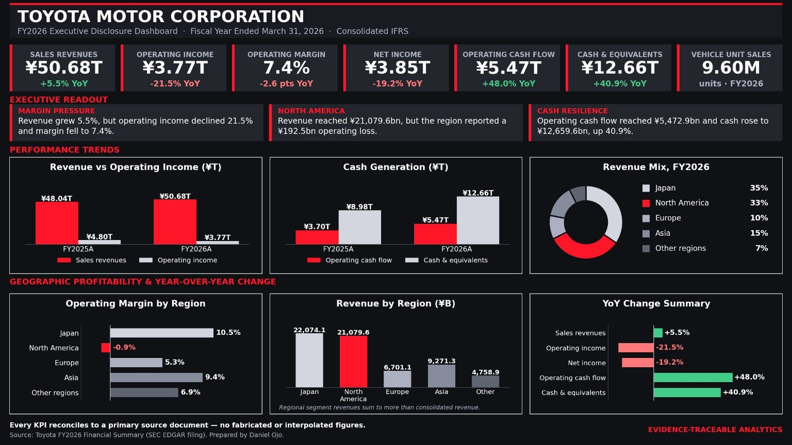

# Toyota FY2026 Executive Disclosure Dashboard

> **Thesis:** Every number in an executive dashboard should trace to a primary source. This dashboard presents Toyota's FY2026 consolidated results with every KPI reconciled to the official SEC EDGAR filing.

Executive financial dashboard built from Toyota's FY2026 Financial Summary (FY ended March 31, 2026), consolidated IFRS. All figures are sourced from the official filing — no interpolated or estimated values.

## What this is

A source-linked analytical workbook covering:

- Consolidated KPIs — sales revenue, operating income, operating margin, net income, cash flow, cash position, vehicle unit sales
- Year-over-year comparison — FY2025A vs FY2026A
- Geographic performance — revenue, operating income, and operating margin by region
- Executive readout — margin pressure, North America loss, cash resilience
- Data dictionary and source register

## What this demonstrates

- **Source traceability** — every figure links to a specific page and section of the Toyota FY2026 filing on SEC EDGAR
- **Executive framing** — the dashboard leads with the story, not the raw data
- **Reconciliation discipline** — every KPI is checked against its primary source
- **Data dictionary** — definitions, units, and reporting basis documented for every field
- **No fabrication** — no interpolated, estimated, or modeled values

## Structure

- `data/` — source data extracted from Toyota FY2026 Financial Summary
- `dashboard/` — executive dashboard (Excel workbook)
- `README.md`

## Source

Toyota FY2026 Financial Summary — SEC EDGAR filing  
https://www.sec.gov/Archives/edgar/data/1094517/000119312526213363/d125587dex991.htm

Toyota Financial Results Archive  
https://global.toyota/en/ir/financial-results/archives/

## Author

Anuoluwapo Daniel Ojo — Software Engineer · Data · Finance

- GitHub: [github.com/Daniel38215571](https://github.com/Daniel38215571)
- LinkedIn: [linkedin.com/in/daniel-ojo-879273197](https://linkedin.com/in/daniel-ojo-879273197)
- Email: ojodaniel38@gmail.com
- Location: Lagos, Nigeria (Remote-ready)

Data × AI × Software. Building systems that prove themselves.
